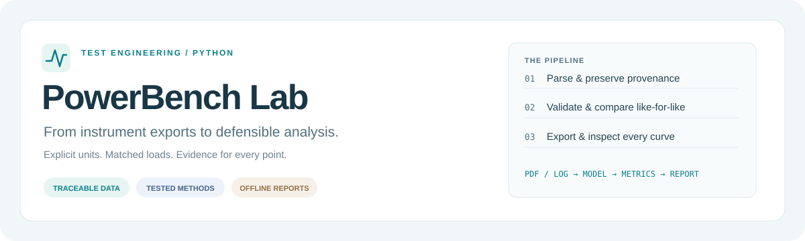
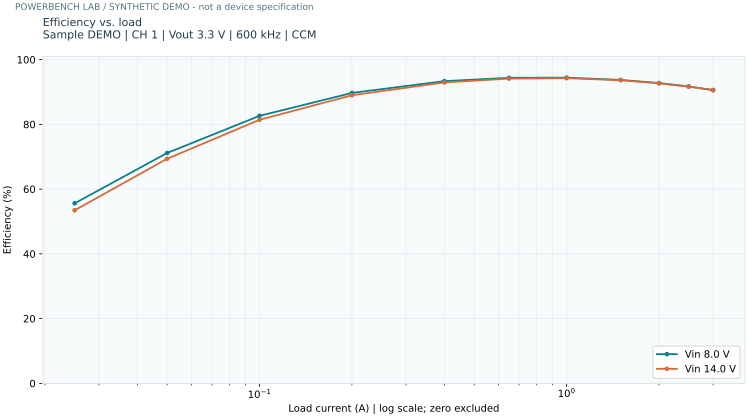

<p align="center">
  
</p>

# PowerBench Lab

**Turn DC–DC converter test exports into traceable data, reproducible analysis, and offline reports.**

[](https://github.com/Gary7702/powerbench-lab/actions/workflows/ci.yml)


[中文入门](README.zh-CN.md) · [Methodology](docs/methodology.md) · [Architecture](docs/architecture.md) · [Download demo HTML](docs/demo/report.html)



*Generated by the real analysis pipeline from synthetic fixtures—not a device performance claim.*

## Why this exists

An engineering bench can produce hundreds of useful measurements—and an equally large collection of awkward PDFs and positional log files. Manually moving curves into a spreadsheet loses context: which channel, operating mode, source file, and actual load produced each point?

This project redevelops a practical Python workflow originally used for power-module characterization. It keeps the electrical context while adding explicit data contracts, failure isolation, regression tests, a distributable package, and a repeatable command line. It is a portfolio project grounded in test engineering, not a claim of a production-certified measurement system.

> **All committed demo data is synthetic.** No employer PDFs, original spreadsheets, personal CV, confidential product identifiers, or real measurements are distributed. The synthetic loss equation is illustrative, not fitted to a device.

## A 60-second tour

Python **3.11 or newer**; Windows, Linux, or macOS. From a checkout of this repository:

```bash
python -m venv .venv
# Windows PowerShell: .venv\Scripts\Activate.ps1
# macOS / Linux: source .venv/bin/activate
python -m pip install -e ".[dev]"
powerbench demo --output outputs/demo --legacy-wide
```

Open `outputs/demo/report.html` in your browser. The demo generates **8 runs × 12 points**, an intentionally undefined efficiency reading, and traceable diagnostics. It needs **no network connection after dependencies are installed**. Each invocation requires a new or empty output directory; existing files are never overwritten.

The report includes:
- Like-for-like curve selection with fixed sample, channel, nominal output, frequency, and mode.
- Efficiency, output-voltage and loss views; linear/logarithmic load axes.
- Point inspection with source, page, table, row, and SHA-256 provenance.
- Per-run summaries, matched-load line regulation, and a searchable quality log.

GitHub does not execute HTML in the file viewer. Download the demo HTML and open it locally, or generate it with the command above.

## Capabilities

| Stage | What the project does |
|---|---|
| Ingest | Born-digital ATE PDFs, versioned table JSON, UTF-8/UTF-16 voltage logs |
| Validate | Required columns, finite numbers, explicit units, efficiency/power consistency, duplicate loads |
| Analyze | Peak efficiency, signed load-regulation deviations, comparable-condition grouping, matched-load line regulation |
| Export | Tidy CSV, structured JSON, styled Excel with an XY chart, SVG/PNG plots, self-contained HTML |
| Audit | Source hashes, row/table/page locations, per-file diagnostics, configuration and artifact manifest |
| Operate | Installable CLI, strict validation mode, optional recursive discovery, no overwrite by default |

**Numerical care matters:** reported efficiency is not silently replaced with `Pout / Pin`; `inf` becomes a flagged missing value, not zero. Line regulation uses actual common load values, not the midpoint row of two unrelated arrays. Replicates and ambiguous duplicate loads are never silently averaged.

## Use your own reports

```bash
# Validate only: no files are created.
powerbench validate ./inputs --json

# Analyze a top-level folder; add --recursive only if needed.
powerbench analyze ./inputs --output outputs/run-01 --config examples/settings.toml

# Match specific actual loads, and produce logarithmic plots in amperes.
powerbench analyze ./inputs --output outputs/run-02 --loads 0,1,2 --log-x

# Compare operating modes instead of input voltages in static figures.
powerbench analyze ./inputs --output outputs/modes --vary mode --formats html,csv,plots

# Return nonzero even on warnings; useful in automated quality gates.
powerbench validate ./inputs --strict

# Voltage logs: explicit positional headers prevent accidental column shifts.
powerbench logs examples/synthetic-voltage.txt --output outputs/logs \
  --headers examples/voltage-headers.json
```

`python -m powerbench` is equivalent to `powerbench` if you prefer an explicit interpreter.

### Supported report contract

Filename:

```text
[__]sample_channel_Vin_Vout_frequency-kHz_mode[_EFFI_YYYY-MM-DD HH-MM-SS].pdf
__DEMO_1_10_5_500_1_EFFI_2026-01-01 12-00-00.pdf
```

Native table columns: `No. Io Vo Vi Ii Po Pi Ploss Effi`. Column order may change; the full recognized header is required. Data is normalized to A, V, W, kHz and efficiency fraction. `channel=S` means merged output. Mode IDs are preserved; customize labels only when verified against your device documentation.

Units are a declared **adapter convention**, not inferred from number magnitudes. Use `efficiency_unit = "percent"` only for a source that truly reports percentages. mA/mV table inputs, arbitrary PDF layouts, scanned/OCR-only PDFs, encrypted files, and arbitrary spreadsheet ingestion are not supported by this release. See [methodology and limits](docs/methodology.md).

### Output layout

```text
outputs/run-01/
├── report.html          # Offline, interactive, no telemetry or CDN
├── analysis.xlsx        # Measurements / Summary / Line Regulation / Diagnostics / Read Me
├── measurements.csv    # One row per observation; conditions and units retained
├── summary.csv
├── line_regulation.csv
├── results.json         # Versioned data plus analysis and diagnostics
├── diagnostics.json    # Always written, including failed batches
├── manifest.json       # Input and output hashes + effective settings
└── plots/              # One comparable-condition chart per group, SVG and PNG
```

`--legacy-wide` adds labelled alternating load/efficiency rows for compatibility with older curve-oriented spreadsheet workflows. It is not the primary data model.

Exit status: **0** = completed without errors; **1** = data errors/no valid runs, or any diagnostic under `--strict`; **2** = usage/configuration/I/O failure. In non-strict mode, good files survive a failed neighbour and the batch still returns failure if any data error occurred. Review `diagnostics.json` before drawing conclusions.

## Engineering, not just plotting

- **Immutable domain objects:** test conditions and observations are separate from parsing and presentation.
- **Inspectable algorithms:** pure-Python interpolation, explicit mean-normalized regulation, no accidental extrapolation.
- **Defensive boundaries:** unsupported schemas fail; headers and units are not guessed; malformed rows produce errors.
- **Safe artifacts:** CSV formula-prefix escaping, literal Excel strings, escaped embedded JSON, no report network access.
- **Automated verification:** formula, parser, batch, log, CLI, serialization, injection, and export regression tests.
- **CI:** quality checks plus Python 3.11–3.13 tests on Linux and Windows, with generated demo artifacts.

```bash
python -m pytest --cov=powerbench --cov-report=term-missing
ruff check .
ruff format --check .
mypy src/powerbench
python -m build
```

The public test suite uses synthetic tables and PDF-reader boundary doubles. Local reference checks against privately extracted historical reports are not committed. CI configuration is not a claim that every platform has already been verified; the badge shows actual runs.

## Scope and next steps

This release focuses on one known ATE report family and a defensive voltage-log adapter. Extensions worth adding are vendor-specific adapters, explicit replicate selection/aggregation policies, uncertainty propagation, and an agreed device-specification pass/fail layer. It intentionally does not control lab instruments or make release decisions.

Maintained by **Gary Feng**. Contributions should include a synthetic fixture, tests, and a documented unit contract. Please do not attach confidential instrument exports to public issues.

[MIT License](LICENSE) · [Data and attribution notice](NOTICE)
