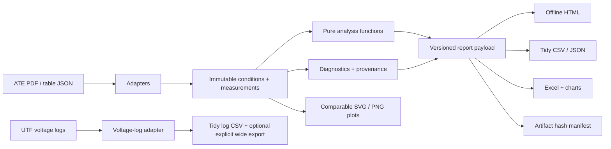

# Architecture and design decisions

## Module boundaries

| Module | Responsibility |
|---|---|
| `models.py` | Immutable nominal conditions, observations, runs, diagnostics and validated settings |
| `parsers.py` | Filename and native report adapters, recognized headers, numeric validation |
| `batch.py` | Explicit input discovery, deterministic ordering, duplicate detection, failure isolation |
| `analysis.py` | Pure descriptive metrics, fixed-condition grouping and no-extrapolation interpolation |
| `logs.py` | Encoding-aware voltage extraction and safe positional export validation |
| `exports.py` | Flat tables, versioned payloads, safe Excel, static plots and manifests |
| `report.py` | Single-file accessible HTML explorer; embedded data, no network |
| `demo.py` | Repeatable synthetic fixtures, explicitly separated from real device claims |
| `cli.py` | Argument validation, orchestration, output safety and exit codes |

The domain does not depend on a browser, dataframe framework, Excel workbook, or filesystem parser. Its records can be built directly in unit tests. Third-party libraries are imported at the boundary that needs them. CSV, JSON, logs, core analysis and HTML use the Python standard library.

## Decisions that correct fragile script behaviour

| Earlier scripting pattern | Deliberate replacement |
|---|---|
| Hard-coded machine paths and execution at import | Explicit CLI arguments, `__main__`, installable entry point |
| Read only the first page / skip a fixed number of rows | All-page adapter and header-driven field mapping |
| Shared class attributes and mutable plotting flags | Frozen records and pure grouping; no hidden plot state |
| One hand-written comparison branch per parameter | One grouping function over an explicit set of condition fields |
| `range(count - 1)` can lose the last singleton | Group every run, including singletons and repeated measurements |
| Map `inf` to zero | Retain missing efficiency with a diagnostic and a visible gap |
| Midpoint array index treated as half load | Interpolate at the midpoint of the common actual-load interval |
| Long arrays pasted into anonymous spreadsheet cells | One observation per row with named fields, units and provenance |
| Positional log arrays with no length check | Tidy long output; wide output only with exact, explicit headers |
| Broad implicit recursion and overwrite | Recursion is opt-in; outputs require a fresh/empty directory |

## Testing strategy

1. **Numerical unit tests:** signed formulas, ties, missing efficiency, nonuniform sampling, endpoints, no extrapolation, ambiguous replicates and load points.
2. **Adapter tests:** synthetic tables and malformed schema variants; page/header continuation; PDF-reader boundary doubles; explicit encoding and log alignment.
3. **Integration tests:** invoke the real CLI with generated JSON inputs; inspect CSV, JSON, workbook XML, charts, HTML data round trips, and artifact hashes.
4. **Security-oriented tests:** malicious source strings cannot terminate embedded JSON, become Excel formulas, or trigger remote report resources.
5. **CI:** style, types, package build, coverage, and demo generation across the configured Python/OS matrix.

Private historical reference material is kept outside the repository and is not required to run the public test suite. Boundary doubles prove the orchestration contract, not universal PDF compatibility; new vendor layouts need dedicated reviewed fixtures.

## Extending without hiding assumptions

A new adapter should return `Run` objects, declare its unit conversion, emit useful source locations, and reject ambiguous metadata. Add a fully synthetic fixture that exercises the same layout and failure modes. Keep device acceptance limits, uncertainty models, and replicate-aggregation policies explicit rather than encoding them as silent defaults.

No backend or account is required. Reports work as local files, so measurement data does not need to leave the workstation.
